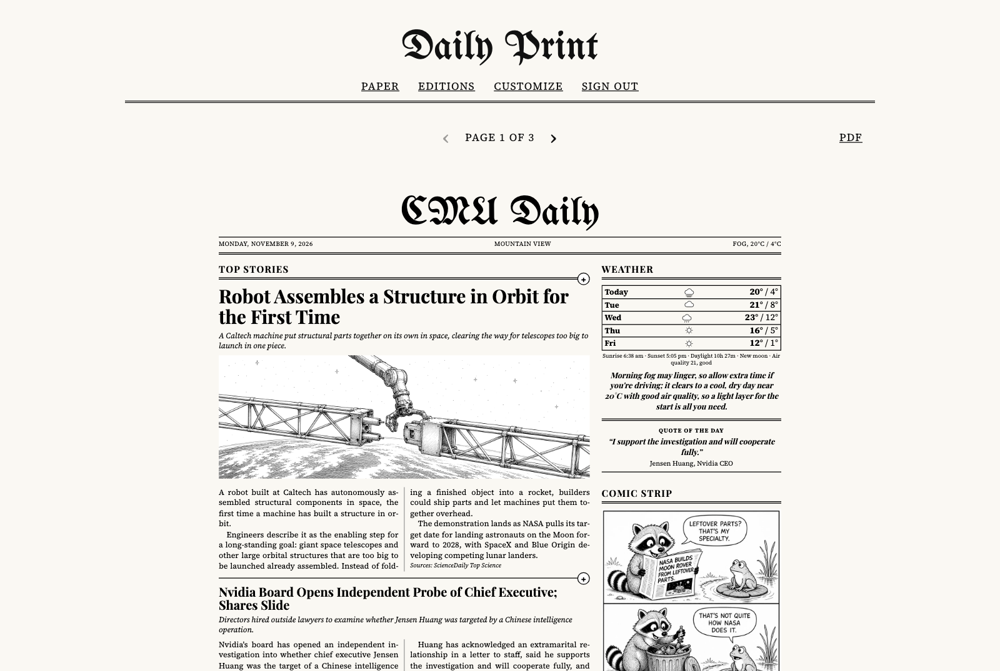
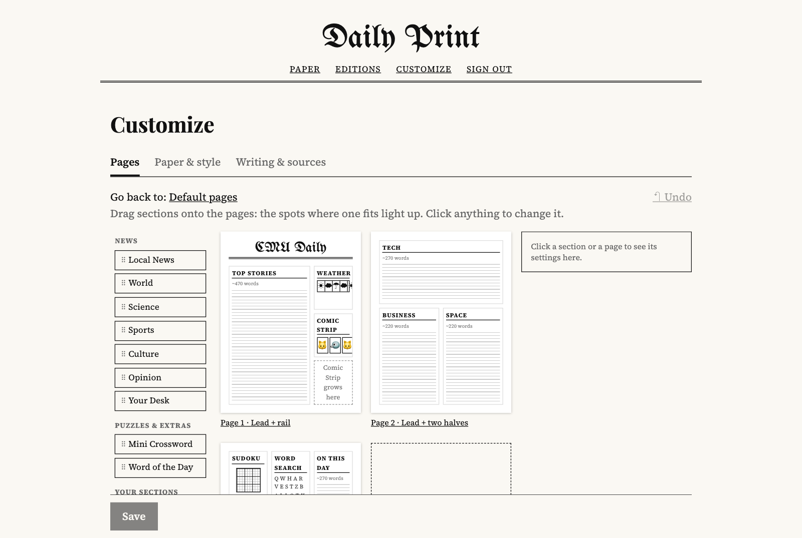
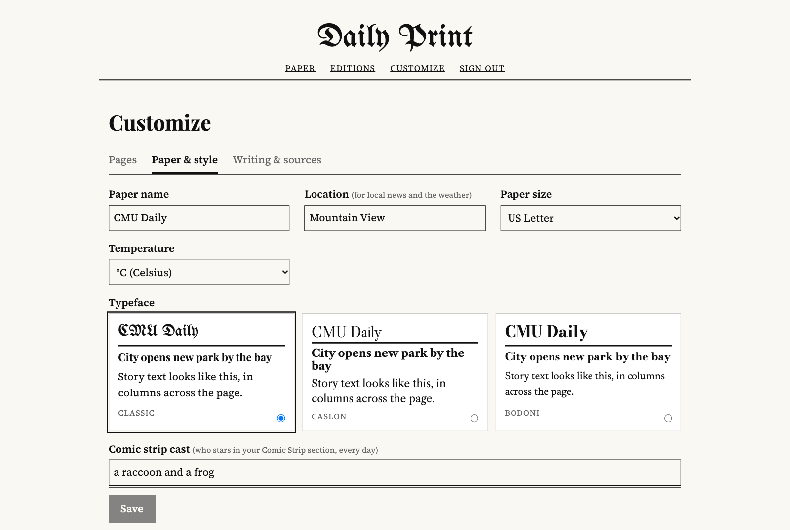

# Daily Print

An AI agent that puts together a personal daily **newspaper**, not a news feed. Each edition is made for one reader: their interests, their location, what they already know. Read it in the browser, or print it.



**The goal: caught up, and done.** When you finish the paper, you know what matters today, and you can stop.

What sets it apart:

- **A news product unlike others.** An AI editor writes the paper for one reader. It learns what they know and care about, so it can skip what they've already read, say what's new instead of retelling the story, and follow up on stories they read about before.
- **A media product unlike others.** It ends. Feeds personalize to keep you scrolling; this paper personalizes to fit more of what matters into the same pages. No streaks, no endless "more", nothing pulling you back.

Why a newspaper and not a news app:

- **It ends.** An edition has a fixed number of pages. Finishing it is the point.
- **It is edited.** The agent decides what makes the front page and what gets cut.
- **It has layout.** Masthead, columns, headlines and sections, like print.
- **It reads on screen and on paper.** The web page and the PDF are the same pages, line for line.

**Try it:** [daily-print.vercel.app](https://daily-print.vercel.app). Anyone can sign in and design a paper; making papers is limited to invited readers for now, and everyone else sees sample papers. To make your own, [run your own copy](#run-your-own-copy).

## How it works

1. **You design your paper** on the Customize page: its name, pages, sections, typeface, tone and the sources to trust or avoid.
2. **An AI editor makes each edition.** Claude researches each section on the web, then writes the stories, the weather tip and the puzzles to fit the space on each page. Pictures (a front-page illustration and a comic strip) come from OpenAI or Google.
3. **You read it** on the Paper page, page by page, or as a PDF. Follow a story with **+** and the next editions follow up on it.
4. **Or it prints itself.** Set a print time, and a printer box (a Mac or Raspberry Pi by your printer) prints the paper every morning.

| Pages: drag sections onto the pages | Paper & style: name, place, size, typeface |
|---|---|
|  |  |

More detail: [docs/ARCHITECTURE.md](docs/ARCHITECTURE.md).

## Run your own copy

### What you need

| Account | For | Required? |
|---|---|---|
| [Anthropic](https://console.anthropic.com) API key | Researching and writing each edition, about **$1 each** | Yes |
| [Supabase](https://supabase.com) project (free plan) | Sign-in, the database and the PDFs | For the web app |
| [Google Cloud](https://console.cloud.google.com) OAuth client | Signing in with Google, and birthdays from Google Calendar | For the web app |
| [OpenAI](https://platform.openai.com) or [Google AI](https://aistudio.google.com) API key | The illustration and the comic strip. Without one, the paper prints a placeholder and the comic in words | No |
| [Vercel](https://vercel.com) (free plan) | Making the paper every morning while your computer sleeps | No |
| A printer | Printing at home: see [Printing](#print-it) | No |

You also need **Node 24** or later. Set a monthly spending limit with Anthropic (and OpenAI or Google), so a bug or a leaked key can only cost so much.

### Quickest start: one paper, no web app

```
npm install
npx playwright-core install chromium   # the browser that prints the PDF
cp .env.example .env                   # then add your ANTHROPIC_API_KEY
npm run paper
```

The paper is saved to `editions/YYYY-MM-DD.pdf`, with its text and cost in `editions/YYYY-MM-DD.json`. Change the paper in [paper.json](paper.json): its name, location, pages and sections. New readers in the web app start with these settings too.

Have a Claude subscription? `USE_CLAUDE_CODE=1 npm run paper` runs Claude through the [Claude Code](https://claude.com/claude-code) CLI on this machine instead of the API. That's for personal testing only, never on Vercel.

### The web app

1. **Supabase:** create a project. Under Project Settings → API Keys, copy the URL, the publishable key and a secret key into `.env`. Then create the tables and storage: `npx supabase login`, `npx supabase link`, `npx supabase db push`.
2. **Google sign-in:** in Google Cloud, create an OAuth client of type "Web application" with the redirect URI shown on Supabase's Authentication → Providers → Google page. Paste its client ID and secret into that page, and into `GOOGLE_CLIENT_ID` and `GOOGLE_CLIENT_SECRET` in `.env`. Turn Google on.
3. **Redirect URLs:** under Supabase's Authentication → URL Configuration, add `http://localhost:3000/auth/callback` (and later your Vercel address plus `/auth/callback`).
4. **Who can make papers:** put your email in `ALLOWED_EMAILS`. Each paper costs money, so only these readers get them; anyone else can sign in and customize, and sees sample papers.
5. **Birthdays (optional):** in Google Cloud, turn on the **Google Calendar API**, add the `calendar.events.readonly` scope under Data Access, and add `http://localhost:3000/api/google/callback` (and your Vercel address plus `/api/google/callback`) to the OAuth client's redirect URIs. Set the app's publishing status to **In production**; in Testing, Google cancels the access every 7 days.
6. **Run it:** `npm run dev`, then open http://localhost:3000.

Good to know while running it locally:

- `npx workflow web` shows each edition being made.
- Editions keep going in the background: stopping the dev server only pauses them. **Stop** on the Editions page ends one.
- Don't run `next build` while the dev server is running: it wipes the progress of editions being written.

### Deploy to Vercel

1. Import the repository on Vercel. [vercel.json](vercel.json) already says it's a Next.js app and sets the daily scheduler.
2. Set `CRON_SECRET` in `.env` to a long random value (`openssl rand -hex 32`). Vercel sends it when it runs the scheduler, so no one else can.
3. Add every variable from `.env` on Vercel (`vercel env add NAME`), without `USE_CLAUDE_CODE`. Mark the keys and secrets **Sensitive**.
4. Add your Vercel address to Supabase's redirect URLs and to the Google OAuth client (step 3 and 5 above).
5. In Vercel's Settings → Git, keep **Git Fork Protection** on, so pull requests from forks never deploy with your keys.

### Print it

- **Whenever you like:** open a paper's **PDF** and print it from your browser.
- **Every morning:** set a print time in Customize, and set up a **printer box**: a Mac or Raspberry Pi next to your printer that prints the paper when it's ready. Your printer, double-sided printing and other options are set on the box. See [docs/PRINTER_SETUP.md](docs/PRINTER_SETUP.md).

To try the morning paper on your computer before deploying: set the print time about 25 minutes ahead and Save. The Editions page shows it as **Scheduled**, and it's written 20 minutes before the print time. To run the daily scheduler by hand: `curl -H "Authorization: Bearer $CRON_SECRET" http://localhost:3000/api/cron`.

## Where things live

| Folder | What's in it |
|---|---|
| [app/](app/) | The web app's pages: the landing page, Paper, Editions and Customize ([app/customize/](app/customize/)), plus [actions.ts](app/actions.ts) (what the buttons do) and [api/](app/api/) (the daily scheduler, the printer box and Google) |
| [workflows/edition.ts](workflows/edition.ts) | Making one edition, step by step: research, write, draw, print the PDF, save |
| [lib/edition/](lib/edition/) | The editor: researching and writing with Claude ([editor.ts](lib/edition/editor.ts), [claude.ts](lib/edition/claude.ts)), and how many words fit each spot ([space.ts](lib/edition/space.ts)) |
| [lib/paper/](lib/paper/) | Drawing the newspaper, the same on screen and in the PDF: the components ([newspaper.tsx](lib/paper/newspaper.tsx), [features.tsx](lib/paper/features.tsx)), the stylesheet ([css.ts](lib/paper/css.ts)) and printing the PDF ([render.ts](lib/paper/render.ts)) |
| [lib/extras/](lib/extras/) | Everything besides the news: the forecast, puzzles, pictures and birthdays |
| [lib/printing/](lib/printing/) | Scheduling the morning paper and the printer box's keys |
| [lib/](lib/) | Shared by all: what a reader can choose ([settings.ts](lib/settings.ts)), who can make papers ([allowed.ts](lib/allowed.ts)), dates ([today.ts](lib/today.ts)) and the database clients ([supabase/](lib/supabase/)) |
| [public/printer/](public/printer/) | The printer box's install and print scripts |
| [public/samples/](public/samples/) | Sample papers, shown to readers who can't make papers yet |
| [scripts/paper.ts](scripts/paper.ts) | `npm run paper`: one paper from paper.json, without the web app |
| [supabase/migrations/](supabase/migrations/) | The database tables, their security rules, and storage for PDFs and pictures |

## Docs

| File | What's in it |
|---|---|
| [docs/ARCHITECTURE.md](docs/ARCHITECTURE.md) | How the parts fit together: the edition workflow, Stop, scheduling and printing |
| [docs/PRINTER_SETUP.md](docs/PRINTER_SETUP.md) | Printing on your own printer: from the browser, or with a printer box on a Mac or Raspberry Pi |
| [docs/DECISIONS.md](docs/DECISIONS.md) | How things are decided, by topic, and why |
| [docs/OPEN_QUESTIONS.md](docs/OPEN_QUESTIONS.md) | Unknowns still to resolve |
| [docs/TODO.md](docs/TODO.md) | What's next |

## Status

Built: a web app where readers sign in with Google, design their paper on the Customize page, and read each edition on the Paper page, turning pages left and right, or as a PDF. Editions are made on demand, or every morning for a printer box at home. Readers can follow a story with + on the Paper page; updates on it appear in the Your Desk section. Next: printing by itself every morning from the deployed app, and explaining any term on the web view. See [docs/TODO.md](docs/TODO.md).

## License

[MIT](LICENSE): use it, change it and share it, keeping the copyright notice.
