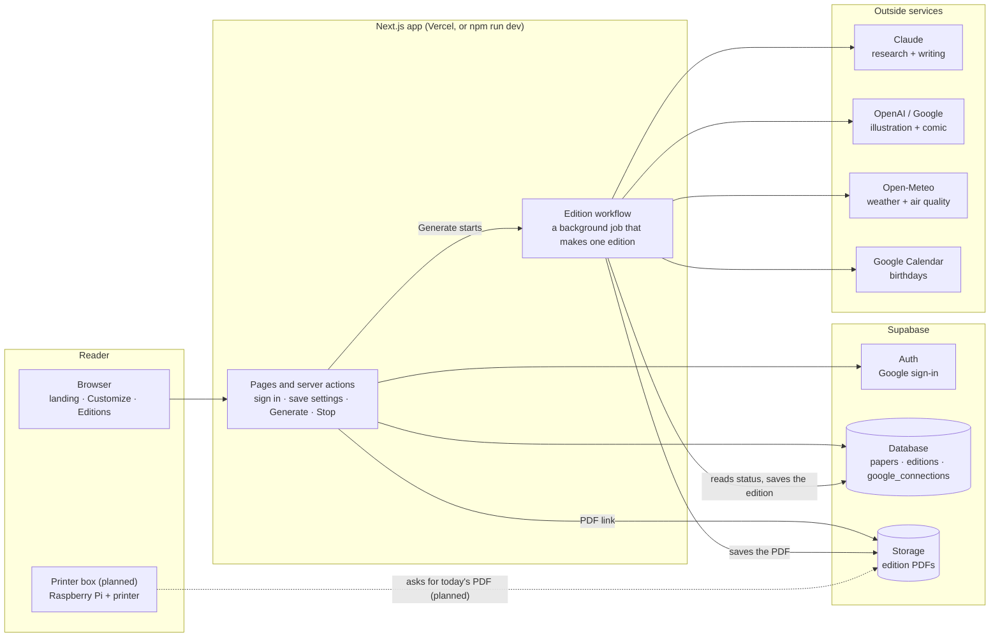
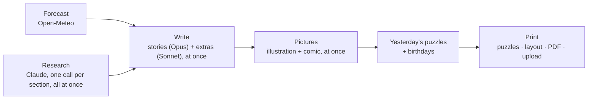
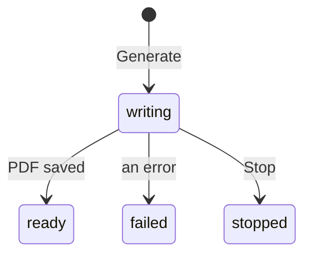

# Architecture

How Daily Print works today, and what's planned. Decisions behind it are in [DECISIONS.md](DECISIONS.md).

## The parts

| Part | What it does | Code |
|---|---|---|
| **Pages and server actions** | The screens, plus the small server functions they call: save settings, start an edition, stop one, connect Google | [app/](../app/) |
| **Edition workflow** | Makes one edition from start to finish, in steps (below) | [workflows/edition.ts](../workflows/edition.ts) |
| **Edition pipeline** | The work itself, shared by the workflow and `npm run paper`: research, writing, pictures, puzzles, layout, PDF | [lib/](../lib/) |
| **Supabase** | Who you are (Auth), your settings (`papers`), each edition and its status (`editions`), your Google connection (`google_connections`) and the PDFs (Storage) | [supabase/migrations/](../supabase/migrations/) |

## Making an edition

Pressing **Generate** adds a row to `editions` with status **writing**, starts the edition workflow, and returns at once. The workflow then runs these steps:

Before each costly step, the workflow checks that the edition is still **writing**. When it finishes, it sets the status to **ready** and saves the text and puzzles. If anything fails, it sets **failed** with the error.

### Why a background job

An edition takes about 3 minutes. That's too long for a web request: the browser would wait, and Vercel ends requests after a few minutes. So Generate starts a **workflow** (the [Workflow SDK](https://workflow-sdk.dev)) and returns right away. A workflow is a function split into steps, where each finished step's result is saved. If the server restarts mid-edition, the workflow carries on from the last finished step, instead of starting over and paying for Claude again.

### Who controls it

**The edition's status in the database is the only control.** **Stop** sets the status to **stopped**. The workflow reads the status before each costly step and quits when it isn't **writing**. A step already running (for example, a 1-minute Claude call) finishes first, and its result is thrown away.

The app never keeps track of the workflow itself. That way, Stop works the same everywhere, including when a workflow has been lost: the edition is marked stopped either way and never stays **writing** forever.

### Where the workflow runs

| | Deployed (Vercel) | Local (`npm run dev`) |
|---|---|---|
| Runs the steps | Vercel Functions | Your dev server |
| Saves its progress | Vercel's workflow service | Files in `.next/workflow-data` |
| After a restart | Carries on | Carries on the next time you run `npm run dev` |
| See what's running | Vercel dashboard → Workflows | `npx workflow web` |
| Database and PDFs | Supabase | The same Supabase project |

Two things to know about local runs:
- **Stopping `npm run dev` only pauses editions.** They carry on the next time it starts. Use **Stop** to end one.
- **`next build` deletes `.next`, including the progress of editions being written.** Don't build while the dev server is running. A lost edition stays **writing** until you press Stop.

## Without the web app: `npm run paper`

[scripts/paper.ts](../scripts/paper.ts) runs the same pipeline in one go, in the terminal, from [paper.json](../paper.json), and saves the PDF to `editions/`. It doesn't use the workflow or Supabase, so it doesn't resume: Ctrl+C ends it. With `USE_CLAUDE_CODE=1`, Claude runs through Claude Code on your subscription instead of the API key. That's for testing on your own computer only.

## Planned

- **Scheduler:** start each reader's edition early enough to be ready at their print time (a Vercel cron job that starts the same workflow).
- **Printer box:** a Raspberry Pi that downloads the morning's PDF and prints it. The hardware works ([PRINTER_SETUP.md](PRINTER_SETUP.md)); the software isn't built yet.
