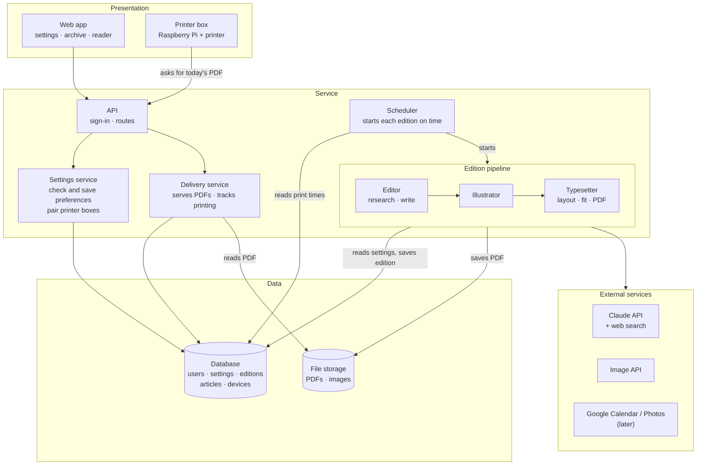

# Architecture

## What goes in each bucket

| Bucket               | Owns                                                                                                                                                                                      | Does not                                                               |
| -------------------- | ----------------------------------------------------------------------------------------------------------------------------------------------------------------------------------------- | ---------------------------------------------------------------------- |
| **Web app**          | Screens: settings form, archive of past editions, reading in the browser                                                                                                                  | Call Claude or the database directly. It only talks to the API         |
| **Printer box**      | Asking whether there's an edition to print, downloading the PDF, sending it to the printer, reporting "printed" or an error                                                               | Hold API keys for Claude, or know anything about how editions are made |
| **API**              | The one entry point for the web app and printer box: sign-in, then passing each request to the right service                                                                              | Contain business rules of its own                                      |
| **Settings service** | Rules for valid settings, such as allowed typefaces, page count and sections. Linking a printer box to a reader's account                                                                 | Generate editions                                                      |
| **Scheduler**        | Deciding _when_: starting each reader's edition early enough before their print time                                                                                                      | Decide _what_ goes in the paper                                        |
| **Edition pipeline** | Everything between settings and a finished PDF. The **Editor** chooses and writes stories, the **Illustrator** makes pictures and the **Typesetter** handles page size, fonts and fitting | Know about users, schedules, printers or how the PDF gets delivered    |
| **Delivery service** | Getting a finished PDF to the reader: the web download, the printer box, and print status                                                                                                 | Change the content of an edition                                       |
| **Data**             | Storing and loading records and files                                                                                                                                                     | Business rules                                                         |
