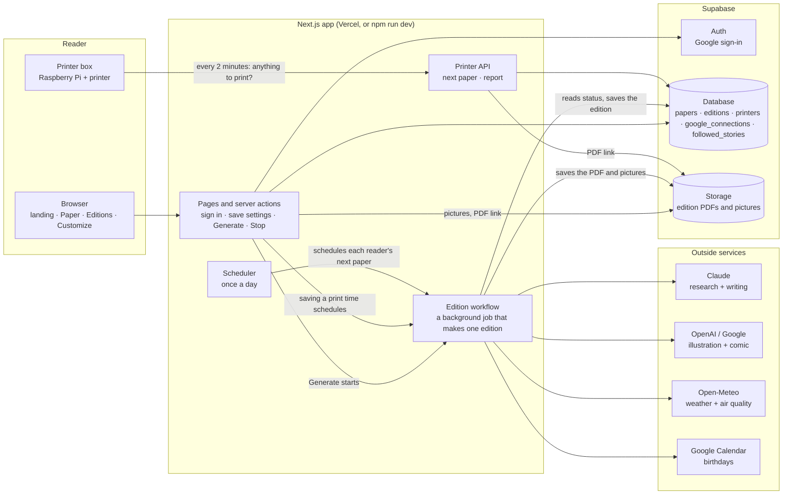
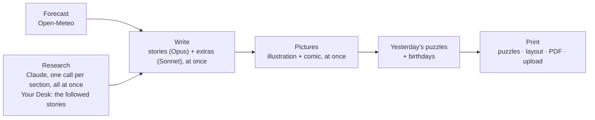
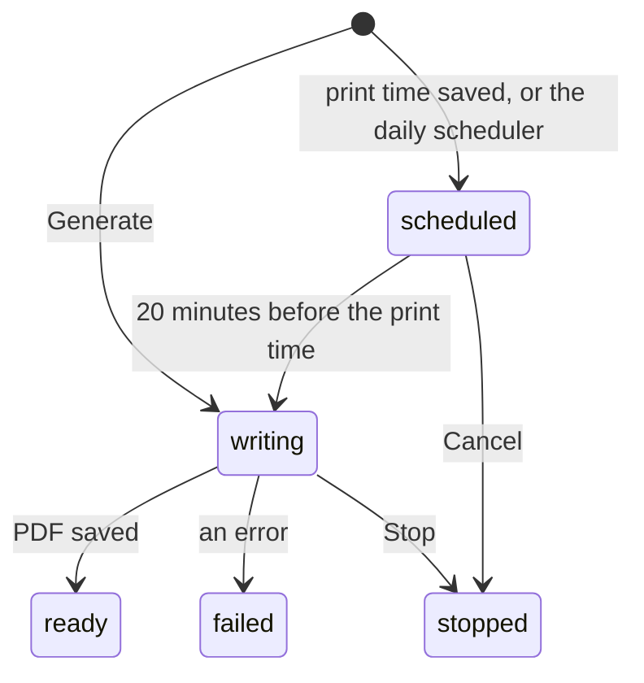

# Architecture

How Daily Print works today, and what's planned. Decisions behind it are in [DECISIONS.md](DECISIONS.md).

## The parts

| Part | What it does | Code |
|---|---|---|
| **Pages and server actions** | The screens, plus the small server functions they call: save settings, start an edition, stop one, connect Google | [app/](../app/) |
| **Edition workflow** | Makes one edition from start to finish, in steps (below) | [workflows/edition.ts](../workflows/edition.ts) |
| **Scheduler** | Schedules each reader's next paper for the printer box | [lib/schedule.ts](../lib/schedule.ts), [app/api/cron](../app/api/cron/route.ts) |
| **Printer API** | Answers the printer box: the paper to print, if any, and its report afterwards | [app/api/printer](../app/api/printer/), [lib/printer.ts](../lib/printer.ts) |
| **Printer box** | A Raspberry Pi that checks every 2 minutes, prints the paper and reports back | [public/printer/](../public/printer/), [PRINTER_SETUP.md](PRINTER_SETUP.md) |
| **Edition pipeline** | The work itself, shared by the workflow and `npm run paper`: research, writing, pictures, puzzles, layout, PDF | [lib/](../lib/) |
| **Supabase** | Who you are (Auth), your settings (`papers`), each edition and its status (`editions`), your printer box's key (`printers`), your Google connection (`google_connections`), the stories you follow (`followed_stories`) and the PDFs (Storage) | [supabase/migrations/](../supabase/migrations/) |

## Making an edition

Pressing **Generate** adds a row to `editions` with status **writing**, starts the edition workflow, and returns at once. The workflow then runs these steps:

Before each costly step, the workflow checks that the edition is still **writing**. When it finishes, it sets the status to **ready** and saves the text and puzzles. If anything fails, it sets **failed** with the error.

The paper is drawn by React components ([lib/paper.tsx](../lib/paper.tsx)) with one stylesheet ([lib/paper-css.ts](../lib/paper-css.ts), scoped to `.paper`). The print step draws them in Chromium and measures the **fit**: each page's font size after shrinking to fit, which section each filler went into, and the comic's height. It prints the PDF from the pages drawn with that fit, and saves the edition's **layout** (settings, date, yesterday's puzzles, picture paths and the fit) next to its text. The pictures go to Storage (`<reader>/<edition>-illustration` and `-comic`). The **Paper** page draws the latest edition with the same components, layout and stylesheet, so it lays out exactly like the PDF, and it's a real web page that new features can build on. Story text is hyphenated by the code (soft hyphens), not the browser, so every browser breaks lines where the PDF does. Hard terms the editor picked are wrapped in `.term` spans; only the site's stylesheet underlines them, and the Paper page shows their definitions. The Paper page also passes `Newspaper` a **follow button** for each story (`app/client.tsx`), which the PDF never gets: it sits on the rule above the story, positioned so it moves no text. Following saves the story's headline and deck in `followed_stories`; the next edition's research looks up what's new on each, and the editor writes an update on each in **Your Desk**, marked with the headline it `follows`. On screen, a small `@media screen` block shows the pages as sheets on a gray background.

### Why a background job

An edition takes about 3 minutes. That's too long for a web request: the browser would wait, and Vercel ends requests after a few minutes. So Generate starts a **workflow** (the [Workflow SDK](https://workflow-sdk.dev)) and returns right away. A workflow is a function split into steps, where each finished step's result is saved. If the server restarts mid-edition, the workflow carries on from the last finished step, instead of starting over and paying for Claude again.

### Who controls it

**The edition's status in the database is the only control.** **Stop** sets the status to **stopped**. The workflow reads the status before each costly step and quits when it isn't **writing**. A step already running (for example, a 1-minute Claude call) finishes first, and its result is thrown away.

The app never keeps track of the workflow itself. That way, Stop works the same everywhere, including when a workflow has been lost: the edition is marked stopped either way and never stays **writing** forever.

### Where the workflow runs

| | Deployed (Vercel) | Local (`npm run dev`) |
|---|---|---|
| Runs the steps | Vercel Functions | Your dev server |
| Saves its progress | Vercel's workflow service | Files in `.next/workflow-data` |
| After a restart | Carries on | Carries on the next time you run `npm run dev` |
| See what's running | Vercel dashboard → Workflows | `npx workflow web` |
| Database and PDFs | Supabase | The same Supabase project |

Two things to know about local runs:
- **Stopping `npm run dev` only pauses editions.** They carry on the next time it starts. Use **Stop** to end one.
- **`next build` deletes `.next`, including the progress of editions being written.** Don't build while the dev server is running. A lost edition stays **writing** until you press Stop.

## Printing every morning

Readers set a **print time** in Customize. Their time zone comes from their browser.

1. **Scheduling.** Each reader's next paper is added as a **scheduled** edition, with the moment it should print (`print_at`). This happens when they save their settings, and once a day for everyone, from a Vercel cron job (see [vercel.json](../vercel.json)). Vercel's free plan only allows a job once a day, at a time that can drift by up to an hour, so the job schedules the **next** paper rather than making it.
2. **Waiting.** Each scheduled paper is a workflow that **sleeps** until 20 minutes before its print time. Sleeping uses no computing. Changing the print time cancels the waiting paper and schedules a new one.
3. **Making it.** The workflow wakes, sets the edition to **writing**, loads the reader's settings as they are by then, and makes the edition as usual.
4. **Printing.** The printer box asks the printer API every 2 minutes whether there's a paper. It gets one only when the paper is ready, its print time has come, and it's less than an hour late. It downloads the PDF, prints it, and reports **printed** or the error.
5. **Skipping.** A paper not printed within an hour of its print time is skipped (printer off, out of paper, box offline). The Editions page says what happened: "Prints at 6:30 am", "Printed at 6:31 am", or "Not printed".

**The printer key.** The box proves which reader it belongs to with a secret key, made with **Set up a printer box** in Customize. The key is shown once, inside a setup command to run on the Pi. The app keeps only a scrambled copy (a hash), so the key can't be read back from the database. The Pi saves the key in `/etc/daily-print.conf` and sends it with every request. Making a new key replaces the old one, which stops working.

## Without the web app: `npm run paper`

[scripts/paper.ts](../scripts/paper.ts) runs the same pipeline in one go, in the terminal, from [paper.json](../paper.json), and saves the PDF to `editions/`. It doesn't use the workflow or Supabase, so it doesn't resume: Ctrl+C ends it. With `USE_CLAUDE_CODE=1`, Claude runs through Claude Code on your subscription instead of the API key. That's for testing on your own computer only.

## Planned

- **Pairing with a code** instead of copying a key, for readers who aren't comfortable with a terminal.
- **Printing a paper made with Generate**, on demand.
